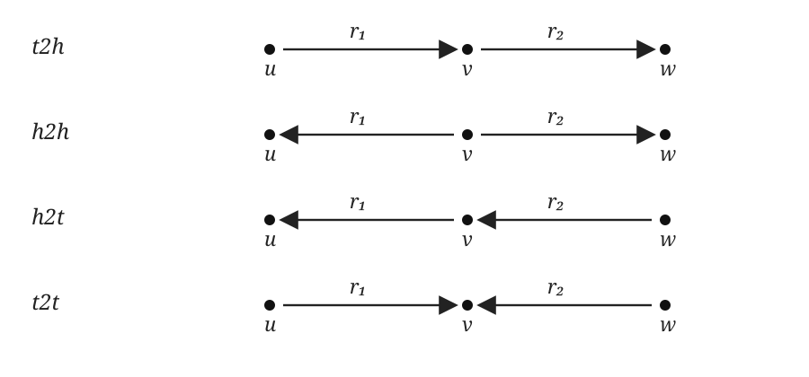

# ULTRA: Inductive Link Prediction on Knowledge Graphs

## 1. Background and Model Overview

Given a query consisting of a source entity `h` and a relation `q`, the model ranks candidate tail entities `t` for the missing fact `(h,q,?)`. This link-prediction task can be used to complete knowledge graphs by suggesting likely missing facts.

ULTRA is designed to generalize to new knowledge graphs, including graphs with unseen entities and different relation vocabularies. It learns structural patterns among relation types rather than relying only on relation names.

The model has two stages: a relation encoder computes query-conditioned relation representations on a relation graph, and an entity encoder uses those representations to propagate information through the knowledge graph and score candidate entities.

## 2. Relation Graph Construction

A knowledge graph is `G=(V,E,R)`, where `V` is the set of entities, `R` is the set of relation types, and `E\subseteq V\times R\times V` is the set of directed facts. A fact `(u,r,v)` means that relation `r` connects head entity `u` to tail entity `v`.

ULTRA constructs a relation graph `L(G)=(V_L,E_L,R_L)`, where each original relation becomes a node:
$$
V_L=R,\qquad
R_L=\{\mathrm{t2h},\mathrm{h2h},\mathrm{h2t},\mathrm{t2t}\},\qquad
E_L\subseteq R\times R_L\times R.
$$

An edge `(r_1,\tau,r_2)\in E_L` exists when two facts in the original KG share an entity in the endpoint configuration specified by `\tau`:
$$
\begin{aligned}
\mathrm{t2h}:&\quad (u,r_1,v)\in E,\quad (v,r_2,w)\in E,\\
\mathrm{h2h}:&\quad (v,r_1,u)\in E,\quad (v,r_2,w)\in E,\\
\mathrm{h2t}:&\quad (v,r_1,u)\in E,\quad (w,r_2,v)\in E,\\
\mathrm{t2t}:&\quad (u,r_1,v)\in E,\quad (w,r_2,v)\in E.
\end{aligned}
$$

The four endpoint patterns are illustrated below. The nodes are entities `u,v,w`, and the directed edges are labeled by relations `r_1` and `r_2`.

These structural connections let the model reason about relations through their positions in graph patterns, even when relation labels differ between knowledge graphs.

## 3. ULTRA Model

ULTRA uses two message-passing stages: a **relation encoder** updates relation representations on the relation graph, and an **entity encoder** propagates query-conditioned information through the entity graph.

### 3.1 Learn Relation Representations

For a query relation `q`, the initial representation of relation node `r` is
$$
\mathbf{h}_{r\mid q}^{(0)}
=
\begin{cases}
\mathbf{1}_d & r=q,\\
\mathbf{0}_d & r\ne q.
\end{cases}
$$

Each relation-graph edge type `\tau\in R_L` has a learnable embedding `\mathbf{z}_\tau\in\mathbb{R}^d`. The message along an edge of type `\tau` is
$$
\mathrm{msg}_{\tau}(\mathbf{h}_{r'\mid q}^{(t)})
=
\mathbf{h}_{r'\mid q}^{(t)}\odot\mathbf{z}_{\tau},
$$
where `\odot` denotes element-wise multiplication.

The relation update first computes a message-passing candidate:
$$
\widetilde{\mathbf{h}}_{r\mid q}^{(t+1)}
=
\mathrm{ReLU}\left(
\mathrm{LN}\left(
W_1^{(t)}
\left[
\mathbf{h}_{r\mid q}^{(t)}
\parallel
\sum_{(r',\tau)\in N_{R_L}(r)}
\mathbf{h}_{r'\mid q}^{(t)}\odot\mathbf{z}_{\tau}
\right]
+\mathbf{b}_1^{(t)}
\right)
\right).
$$
The layer output includes a residual connection when input and output dimensions match:
$$
\mathbf{h}_{r\mid q}^{(t+1)}
=
\begin{cases}
\widetilde{\mathbf{h}}_{r\mid q}^{(t+1)}+\mathbf{h}_{r\mid q}^{(t)},&
\dim(\mathbf{h}_{r\mid q}^{(t+1)})=\dim(\mathbf{h}_{r\mid q}^{(t)}),\\
\widetilde{\mathbf{h}}_{r\mid q}^{(t+1)},&\text{otherwise}.
\end{cases}
$$

Here `\parallel` denotes concatenation, and `N_{R_L}(r)` is the typed neighborhood of relation node `r`. The message function is element-wise multiplication by the edge-type embedding. The update function applies a linear transformation, LayerNorm, and ReLU. As in the notebook implementation, the residual is added after the convolution output when consecutive hidden states have the same shape.

### 3.2 Learn Entity Representations

For a query `(h,q,?)`, the source entity `h` is initialized with the query-conditioned representation of relation `q`; other entities receive zero boundary features. An edge with relation `r` sends a message from entity `w` to entity `v`:
$$
\mathbf{m}_{w\to v}
=
\mathbf{h}_{w\mid h,q}^{(\ell)}
\odot
\mathrm{MLP}\!\left(\mathbf{h}_{r\mid q}^{(T)}\right).
$$

The entity update candidate is
$$
\widetilde{\mathbf{h}}_{v\mid h,q}^{(\ell+1)}
=
\mathrm{ReLU}\left(
\mathrm{LN}\left(
W^{(\ell)}
\left[
\mathbf{h}_{v\mid h,q}^{(0)}
\parallel
\sum_{w\in N_r(v)}
\mathbf{h}_{w\mid h,q}^{(\ell)}
\odot
\mathrm{MLP}\!\left(\mathbf{h}_{r\mid q}^{(T)}\right)
\right]
+\mathbf{b}^{(\ell)}
\right)
\right).
$$
The entity layer also adds a residual connection when input and output dimensions match:
$$
\mathbf{h}_{v\mid h,q}^{(\ell+1)}
=
\begin{cases}
\widetilde{\mathbf{h}}_{v\mid h,q}^{(\ell+1)}+\mathbf{h}_{v\mid h,q}^{(\ell)},&
\dim(\mathbf{h}_{v\mid h,q}^{(\ell+1)})=\dim(\mathbf{h}_{v\mid h,q}^{(\ell)}),\\
\widetilde{\mathbf{h}}_{v\mid h,q}^{(\ell+1)},&\text{otherwise}.
\end{cases}
$$

The entity message function combines the neighbor representation with a learned projection of the query-conditioned relation representation by element-wise multiplication. As in the relation encoder, the update uses a linear transformation, LayerNorm, and ReLU.

To score a candidate tail `t`, the model concatenates its final entity representation with the query representation and passes the result through a two-layer scoring MLP:
$$
s(h,q,t)
=
\mathrm{MLP}_{\mathrm{score}}
\left(
\mathbf{h}_{t\mid h,q}^{(L)}
\parallel
\mathbf{h}_{q\mid q}^{(0)}
\right).
$$
Higher scores indicate more likely candidate tails.

## 4. Evaluation Datasets

The notebook evaluates ULTRA on eight inductive datasets:

- **NELLInductive:** versions `v1`, `v2`, `v3`, and `v4`, based on NELL.
- **WKIngram:** variants `25`, `50`, `75`, and `100`, based on WikiData and prepared in the InGram format.

The notebook loads a pretrained checkpoint, `3g_reproduced.pth`, for evaluation. It states that the checkpoint was pretrained on FB15k237, WN18RR, and CodExMedium, and that NELL and WikiData were unseen during pretraining.

## 5. Filtered Ranking Evaluation

For each test triple `(h,r,t)`, the evaluator ranks candidates for both tail prediction `(h,r,?)` and head prediction `(?,r,t)`. Head prediction is converted into an equivalent tail-prediction query using the inverse relation.

Some queries have multiple correct answers. In filtered evaluation, other known correct answers are removed from the candidate set so they are not counted as negatives. The current target `t` remains in the set.

Let `T^{-}` denote the candidate entities remaining after filtering, and let `s(x)` be the model score for candidate `x`. The rank of the correct target is
$$
\boxed{
\mathrm{rank}(t)
=
1+
\sum_{x\in T^{-}}
\mathbb{I}\big[s(x)\ge s(t)\big]
}
$$
where `\mathbb{I}[\cdot]` equals 1 when the condition is true and 0 otherwise. Thus, the target's rank is one plus the number of remaining candidates scored at least as highly.

For NELL, the test filtering graph combines the inference graph with validation and test target edges. For WKIngram, the validation and test filtering graph includes the inference edges and both validation and test target edges.

## 6. Metrics and Results

The evaluator combines filtered ranks for head and tail prediction. Given `N` evaluation ranks `rank_i`, it reports:
$$
\mathrm{MR}
=
\frac{1}{N}\sum_{i=1}^{N}rank_i,
\qquad
\mathrm{MRR}
=
\frac{1}{N}\sum_{i=1}^{N}\frac{1}{rank_i},
$$
$$
\mathrm{Hits@}k
=
\frac{\#\{i:rank_i\le k\}}{N},
\qquad k\in\{1,3,10\}.
$$
Lower MR is better; higher MRR and Hits@k are better.

The table reports the actual notebook outputs:

| Dataset | MR | MRR | Hits@1 | Hits@3 | Hits@10 |
|---|---:|---:|---:|---:|---:|
| NELLInductive(v1) | 3.7189 | 0.7071 | 0.6517 | 0.6791 | 0.9279 |
| NELLInductive(v2) | 62.5481 | 0.5086 | 0.3920 | 0.5813 | 0.7150 |
| NELLInductive(v3) | 62.6997 | 0.4963 | 0.3951 | 0.5414 | 0.6954 |
| NELLInductive(v4) | 82.6389 | 0.4530 | 0.3331 | 0.5214 | 0.6835 |
| WKIngram(25) | 163.8585 | 0.2635 | 0.1569 | 0.3156 | 0.4730 |
| WKIngram(50) | 617.6747 | 0.1494 | 0.0814 | 0.1550 | 0.2930 |
| WKIngram(75) | 139.1691 | 0.3446 | 0.2535 | 0.4012 | 0.5022 |
| WKIngram(100) | 637.7028 | 0.1613 | 0.1032 | 0.1777 | 0.2748 |

## 7. Reproducibility Notes

- The evaluation code sets the PyTorch random seed to `1024`.
- Both encoders are configured with seven hidden dimensions of size 64.
- The evaluator uses batches of 16 test triples.
- Device selection uses CUDA when available and otherwise CPU.
- Dataset files and the pretrained checkpoint are downloaded or loaded from the paths configured in the notebook.

## References

- Galkin, M., Yuan, X., Mostafa, H., Tang, J., & Zhu, Z. (2024). *Towards Foundation Models for Knowledge Graph Reasoning*. ICLR.
- Huang, X., Barcelo, P., Bronstein, M. M., Ceylan, I. I., Galkin, M., Reutter, J. L., & Romero Orth, M. (2025). *How Expressive are Knowledge Graph Foundation Models?* arXiv.
